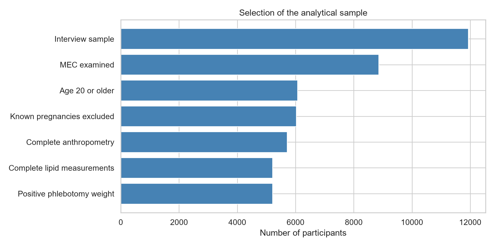
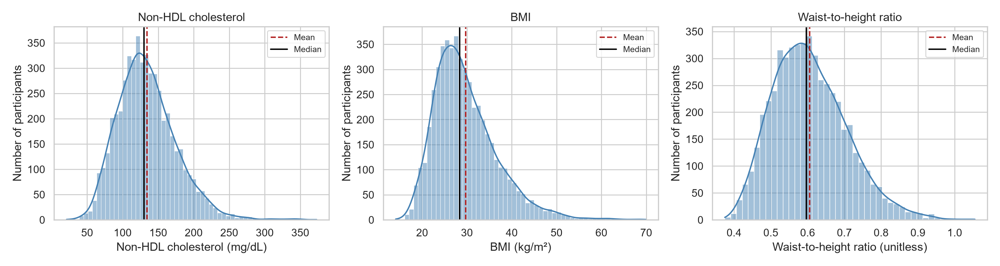
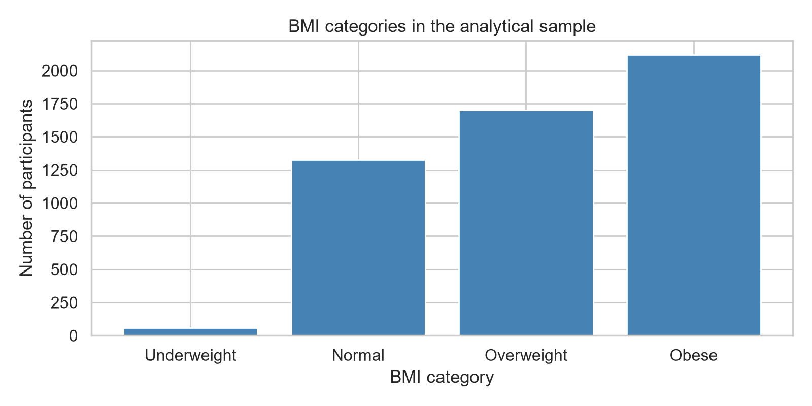
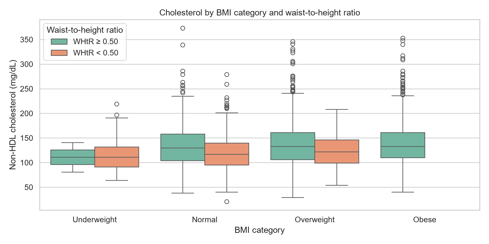

Phase 1
Study design and descriptive statistics

Farhan Behmanesh | Student ID 403170117

NHANES August 2021-August 2023

Question and study design

How do waist-to-height ratio (WHtR) and body mass index (BMI) relate to non-HDL cholesterol among adults, and how do the observed patterns vary by sex, age and income? This phase describes the data and compares cholesterol across adiposity groups. The same measurements are available for each retained participant, making a descriptive comparison possible. Formal inference and adjusted comparisons are reserved for later phases.

NHANES is a cross-sectional observational survey of the US civilian, non-institutionalized population. Household interviews are followed by standardized measurements at mobile examination centers (MECs) and laboratory testing. Its probability sample uses geographic strata, primary sampling units and household selection. Age groups have unequal selection probabilities. Random selection of participants does not make adiposity an assigned treatment, so these data cannot establish causation.

One row represents one participant, identified by SEQN. The source files have unique identifiers and are joined using validated one-to-one left merges onto the interview sample. This preserves people without examination or laboratory records until explicit sample selection. The data are public and de-identified.

Table 1. Source records and identifier checks.

| File | Rows | Unique SEQN | Duplicate SEQN |
| --- | --- | --- | --- |
| DEMO_L | 11933 | 11933 | 0 |
| BMX_L | 8860 | 8860 | 0 |
| TCHOL_L | 8068 | 8068 | 0 |
| HDL_L | 8068 | 8068 | 0 |
| BPQ_L | 8501 | 8501 | 0 |
| SMQ_L | 9015 | 9015 | 0 |

Table 2. Sequential merges onto DEMO_L. Unmatched indicates no record in that component.

| File | Before | After | Matched | Unmatched |
| --- | --- | --- | --- | --- |
| BMX_L | 11933 | 11933 | 8860 | 3073 |
| TCHOL_L | 11933 | 11933 | 8068 | 3865 |
| HDL_L | 11933 | 11933 | 8068 | 3865 |
| BPQ_L | 11933 | 11933 | 8501 | 3432 |
| SMQ_L | 11933 | 11933 | 9015 | 2918 |

Selection and data quality

Table 3. Sample retained and exclusions at each stage.

| Stage | Retained | Excluded at stage |
| --- | --- | --- |
| Interview sample | 11933 | 0 |
| MEC examined | 8860 | 3073 |
| Age 20 or older | 6064 | 2796 |
| Known pregnancies excluded | 6023 | 41 |
| Complete anthropometry | 5709 | 314 |
| Complete lipid measurements | 5205 | 504 |
| Positive phlebotomy weight | 5205 | 0 |

Known pregnancies (RIDEXPRG=1) are excluded. Code 3 means unknown pregnancy status and is retained: 14 women aged 20-44 in the final sample have this code. Pregnancy status is publicly released only for women aged 20-44, so missing codes elsewhere are not evidence of non-pregnancy. The population is described as adults excluding known pregnancies.

The audit normalizes infinitesimal SAS floating values to zero, recodes questionnaire refusal/unknown codes as missing and preserves structural skips. Nonpositive anthropometry/lipids, invalid age or income ranges, and total cholesterol below HDL are checked. No such impossible measurements were found in the supplied snapshot. Valid extreme values are retained. Full counts and actions are saved in quality_audit.csv and missingness.csv.

Table 4. Final sample availability. SMQ040 includes structural skips.

| Variable | Valid | Missing | Missing percent |
| --- | --- | --- | --- |
| All five core measures | 5205 | 0 | 0.00 |
| INDFMPIR | 4548 | 657 | 12.62 |
| BPQ101D | 5185 | 20 | 0.38 |
| SMQ040 | 2132 | 3073 | 59.04 |

Variable scales and continuous summaries

Non-HDL cholesterol (total minus HDL, mg/dL), WHtR (waist/height, both in cm) and BMI (kg/m2) are quantitative continuous ratio variables. Age is recorded in integer years and top-coded at 80; income-to-poverty ratio is continuous and capped at 5. Sex and threshold indicators are binary categories, BMI categories are ordinal, smoking status is nominal and SEQN is an identifier.

Table 5. Unweighted summaries. SD uses n-1; count is variable-specific.

| Variable | count | mean | std | median | Q1 | Q3 | IQR |
| --- | --- | --- | --- | --- | --- | --- | --- |
| Non_HDL_C | 5205 | 134.03 | 41.04 | 130.00 | 105.00 | 158.00 | 53.00 |
| WHtR | 5205 | 0.61 | 0.10 | 0.60 | 0.53 | 0.67 | 0.14 |
| BMXBMI | 5205 | 29.69 | 7.03 | 28.40 | 24.70 | 33.40 | 8.70 |
| RIDAGEYR | 5205 | 53.97 | 16.91 | 57.00 | 40.00 | 68.00 | 28.00 |
| INDFMPIR | 4548 | 3.00 | 1.64 | 2.94 | 1.52 | 5.00 | 3.48 |

Non-HDL cholesterol, BMI and WHtR show upper tails, with means above their medians. Median and IQR resist the influence of extreme observations; mean and SD retain information about the full distribution. The income row uses 4,548 observations, with 657 missing (12.62%). No income values are imputed. Age and income caps must be considered when interpreting their upper quartiles.

Sampling weights and interpretation

Table 6. Unweighted and WTPH2YR-weighted means in the same analytical sample.

| Variable | Unweighted | Phlebotomy weighted |
| --- | --- | --- |
| RIDAGEYR | 53.97 | 48.77 |
| Non_HDL_C | 134.03 | 134.94 |

WTPH2YR is required for this cycle's blood-analyte analyses, including derived non-HDL cholesterol. Interview and MEC weights cover broader components; the phlebotomy weight additionally addresses blood-draw nonresponse. The weighted age mean is lower than the raw mean, consistent with unequal selection and response. Weighting does not guarantee correction for the additional complete-case exclusions. These are descriptive point estimates; survey variance estimation will use SDMVSTRA and SDMVPSU in later work.

Categorical distributions

Table 7. Counts and percentages of all 5,205 retained participants, including unknown smoking status.

| Variable | Category | Count | Percent |
| --- | --- | --- | --- |
| Sex | Female | 2827 | 54.31 |
| Sex | Male | 2378 | 45.69 |
| BMI_Category | Obese | 2120 | 40.73 |
| BMI_Category | Overweight | 1701 | 32.68 |
| BMI_Category | Normal | 1325 | 25.46 |
| BMI_Category | Underweight | 59 | 1.13 |
| High_WHtR | 1 | 4467 | 85.82 |
| High_WHtR | 0 | 738 | 14.18 |
| Age_Group | 60+ | 2378 | 45.69 |
| Age_Group | 40-59 | 1528 | 29.36 |
| Age_Group | 20-39 | 1299 | 24.96 |
| Smoking_Status | Never | 3066 | 58.90 |
| Smoking_Status | Former | 1384 | 26.59 |
| Smoking_Status | Current | 748 | 14.37 |
| Smoking_Status | Unknown | 7 | 0.13 |

The categorical tables distinguish the composition of this retained sample from a population estimate. Central adiposity is common even though the BMI categories separate a range of general body sizes. Unknown questionnaire responses are shown rather than silently removed from the denominator. Current smoking includes every-day or some-day smoking among participants reporting at least 100 lifetime cigarettes.

Descriptive group comparisons

Table 8. Unweighted non-HDL cholesterol by BMI category and central-adiposity status.

| BMI Category | High WHtR | count | mean | median | std |
| --- | --- | --- | --- | --- | --- |
| Underweight | 0 | 57 | 117.56 | 111.00 | 35.30 |
| Underweight | 1 | 2 | 111.00 | 111.00 | 42.43 |
| Normal | 0 | 612 | 119.94 | 117.00 | 34.61 |
| Normal | 1 | 713 | 133.31 | 130.00 | 41.43 |
| Overweight | 0 | 69 | 124.20 | 122.00 | 34.14 |
| Overweight | 1 | 1632 | 136.62 | 133.00 | 42.93 |
| Obese | 0 | 0 | - | - | - |
| Obese | 1 | 2120 | 137.12 | 133.00 | 40.52 |

Within the normal BMI category, participants above the WHtR threshold have a higher median non-HDL cholesterol than those below it. Substantial distributional overlap remains. Small cells, particularly the underweight group with high WHtR, should not support strong generalizations. These are descriptive differences, without a significance claim.

Scope and limitations

The finalized question compares WHtR and BMI as correlates of cholesterol. The complete core measurements support that comparison, while the questionnaire and demographic variables permit later adjustment. Missing income, unknown pregnancy status and selection into the complete-case sample limit interpretation. Age top-coding hides variation above 80. Cross-sectional measurements cannot establish temporal order; medication, diet and other confounders may affect cholesterol. The weighted results target the civilian adult population under the survey weighting assumptions, subject to the additional selection limitations.

Sources

CDC/NCHS public documentation, consulted 20 November 2026. DEMO_L describes the sampling variables and pregnancy codes; TCHOL_L and HDL_L specify WTPH2YR for blood-analyte analysis. The sample-design overview describes age-based selection and nonresponse adjustments.

https://wwwn.cdc.gov/Nchs/Data/Nhanes/Public/2021/DataFiles/DEMO_L.htm

https://wwwn.cdc.gov/Nchs/Data/Nhanes/Public/2021/DataFiles/TCHOL_L.htm

https://wwwn.cdc.gov/Nchs/Data/Nhanes/Public/2021/DataFiles/HDL_L.htm
