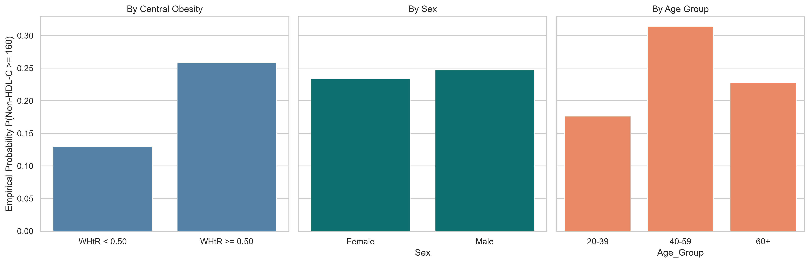
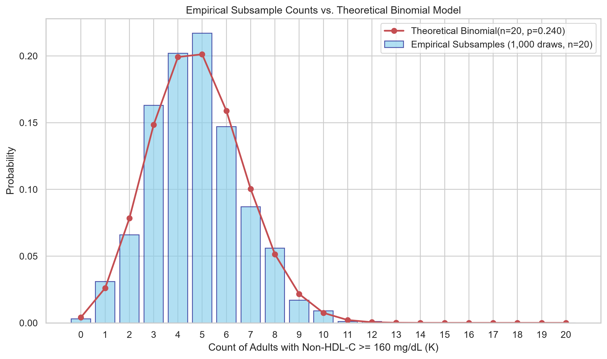
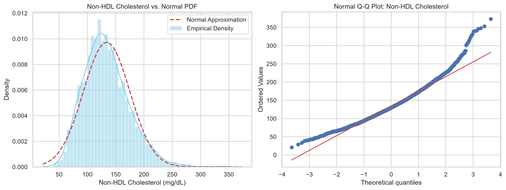
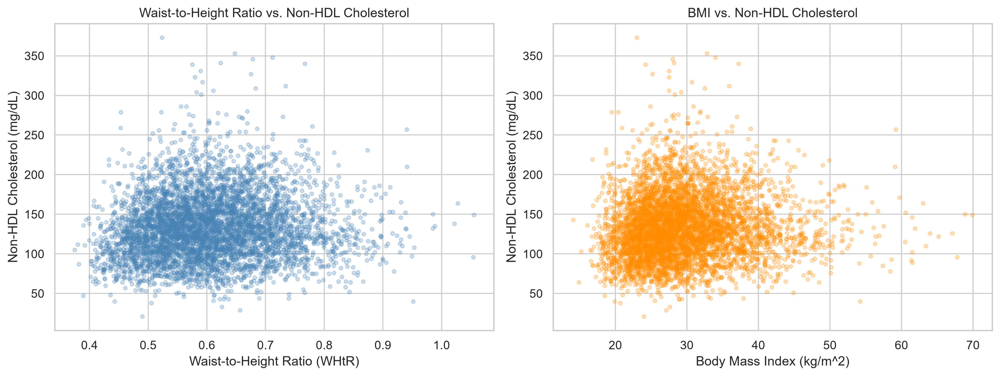

Phase 2
Probability and distributions

Farhan Behmanesh | Student ID 403170117

NHANES August 2021-August 2023

Events and random variables

The sample is the same 5,205 adults used in phase 1, excluding known pregnancies and retaining 14 unknown pregnancy statuses. Each SEQN identifies one participant. A uniform draw from the retained rows defines the unweighted empirical probability space; weighted proportions use WTPH2YR and have a different target interpretation.

Event A is non-HDL cholesterol >=160 mg/dL. Event B is WHtR >=0.50. X is non-HDL cholesterol (mg/dL), Y is WHtR (unitless), and I(A) is the Bernoulli event indicator. K counts event A in a random subsample of 20 distinct retained participants. Thresholds are fixed operational categories, not diagnoses or evidence of future cardiovascular events.

Marginal and joint probabilities

Table 1. Empirical joint probabilities; rows are B and columns are A, with marginal totals.

| High WHtR | 0 | 1 | All |
| --- | --- | --- | --- |
| 0 | 0.1233 | 0.0184 | 0.1418 |
| 1 | 0.6367 | 0.2215 | 0.8582 |
| All | 0.7600 | 0.2400 | 1.0000 |

P(A)=0.2400, P(B)=0.8582, and P(A and B)=0.2215. Under independence the joint probability would equal P(A)P(B)=0.2059. The difference is descriptive evidence of dependence in the empirical distribution, not a formal population independence test.

Conditioning and Bayes theorem

P(A|B)=0.2581, whereas P(A|not B)=0.1301. The former is about 1.98 times the latter. This comparison uses adults below the waist threshold as its reference, not the unconditional P(A).

Bayes theorem gives P(B|A)=P(A|B)P(B)/P(A)=0.9231. The directly counted P(B|A) is also 0.9231. Observing A updates the empirical probability of B from 0.8582 to 0.9231. All computations use unrounded values.

Subgroup probabilities and survey weighting

Table 2. Event A by WHtR indicator, sex and age group. High WHtR: 0=below 0.50, 1=at least 0.50.

| Variable | Group | N | Events | Probability |
| --- | --- | --- | --- | --- |
| High_WHtR | 0 | 738 | 96 | 0.1301 |
| High_WHtR | 1 | 4467 | 1153 | 0.2581 |
| Sex | Female | 2827 | 661 | 0.2338 |
| Sex | Male | 2378 | 588 | 0.2473 |
| Age_Group | 20-39 | 1299 | 229 | 0.1763 |
| Age_Group | 40-59 | 1528 | 479 | 0.3135 |
| Age_Group | 60+ | 2378 | 541 | 0.2275 |

The observed proportions are similar by sex and vary more across age groups, peaking at ages 40-59. Medication use is one possible explanation for the lower observed proportion at ages 60+, but this analysis does not test that explanation. No hypothesis test, causal interpretation or longitudinal risk estimate is implied.

Table 3. Sample proportions and phlebotomy-weighted estimates.

| Event | Unweighted | WTPH2YR weighted |
| --- | --- | --- |
| A | 0.2400 | 0.2436 |
| B | 0.8582 | 0.8316 |

The phlebotomy weight accounts for unequal sampling and blood-draw response under the survey adjustments. The observed weight-induced shifts do not identify a single causal explanation: age, other demographics and response adjustments may all contribute. Complete-case selection can still bias weighted estimates. Proportions here do not include survey confidence intervals.

Counts and the binomial approximation

Table 4. Count means and variances. Simulation variance uses 999 in its denominator.

| Distribution | Mean | Variance |
| --- | --- | --- |
| Binomial | 4.7992 | 3.6476 |
| Hypergeometric | 4.7992 | 3.6343 |
| Simulation | 4.7500 | 3.5410 |

The count support is K=0,...,20. For a binomial model, E[K]=np and Var(K)=np(1-p), with p equal to the pooled empirical proportion. Each simulated subsample is drawn uniformly without replacement. Its exact conditional count distribution is hypergeometric, with variance np(1-p)(N-n)/(N-1). Here n/N=20/5205 is about 0.00384, so the binomial approximation is close; simulation noise also contributes to differences in moments. Exact PMFs for all three distributions are saved in phase2_count_pmf.csv.

A binomial model requires a fixed number of binary trials, independent draws and a common marginal success probability. Independent uniform draws with replacement from this pooled empirical population would satisfy that model. Different clinical subgroup probabilities do not themselves invalidate that pooled model. Without-replacement dependence makes the actual simulation hypergeometric. The original NHANES field design also includes clustering and unequal selection, so this row-sampling exercise must not be treated as a reproduction of the survey design.

Continuous distributions and moments

Table 5. Empirical moments (variance denominator n) and sample summaries (n-1).

| Variable | Empirical mean | Empirical variance | Sample variance | Sample SD |
| --- | --- | --- | --- | --- |
| Non_HDL_C | 134.0257 | 1,684.2399 | 1,684.5635 | 41.0434 |
| WHtR | 0.6060 | 0.0100 | 0.0100 | 0.1001 |

Table 6. Distribution shape and outliers beyond 1.5 IQR fences.

| Variable | Skewness | Excess kurtosis | IQR outliers |
| --- | --- | --- | --- |
| Non_HDL_C | 0.7730 | 1.5032 | 78 |
| WHtR | 0.5708 | 0.3245 | 57 |

The empirical expectation is the average of the finite observed distribution. Empirical variance divides the squared deviations by n, while sample variance and SD use n-1; these are deliberately distinguished. Cholesterol has an empirical mean near 134.03 mg/dL and SD near 41.04 mg/dL. Its variance is measured in (mg/dL)^2. For I(A), E[I(A)]=p and Var(I(A))=p(1-p), about 0.1824, describing variability of a single binary classification.

Non-HDL cholesterol is right-skewed, with 78 IQR outliers and a Q-Q plot that departs from the reference line in the tails. The fitted normal density therefore gives an inadequate description of individual tail probabilities, even if central coverage is reasonably close. WHtR has milder right skew and 57 IQR outliers; exact normality is not assumed. Valid outliers remain in every calculation. A normality test alone is not used as evidence of fit.

Two quantitative variables and covariance

Table 7. Sample variance-covariance matrix using n-1.

| Variable | Non HDL C | WHtR | BMXBMI |
| --- | --- | --- | --- |
| Non_HDL_C | 1,684.5635 | 0.3228 | 18.6013 |
| WHtR | 0.3228 | 0.0100 | 0.6409 |
| BMXBMI | 18.6013 | 0.6409 | 49.4443 |

Both adiposity measures have positive covariance with non-HDL cholesterol, indicating a positive direction of linear co-variation in this sample. The scatter remains broad. Covariance magnitudes cannot directly compare association strength because WHtR and BMI have different scales and units. Standardized associations and regression will be examined later. WHtR and BMI also move together, which matters when both enter a model.

Interpretation and reproducibility

All subgroup and joint calculations describe the retained cross-sectional sample unless explicitly weighted. Selection due to missing anthropometry or laboratory measurements, unknown pregnancy status, treatment and other confounding limit broader interpretation. Neither covariance nor conditional probability establishes causation. The two analysis scripts use the same preparation function, and the reports are regenerated from saved aggregate CSV tables and figures. The binomial simulation uses NumPy default_rng with seed 42.

Sources

CDC/NCHS public documentation, consulted 20 November 2026. DEMO_L describes the sampling variables and pregnancy codes; TCHOL_L and HDL_L specify WTPH2YR for blood-analyte analysis. The sample-design overview describes age-based selection and nonresponse adjustments.

https://wwwn.cdc.gov/Nchs/Data/Nhanes/Public/2021/DataFiles/DEMO_L.htm

https://wwwn.cdc.gov/Nchs/Data/Nhanes/Public/2021/DataFiles/TCHOL_L.htm

https://wwwn.cdc.gov/Nchs/Data/Nhanes/Public/2021/DataFiles/HDL_L.htm
